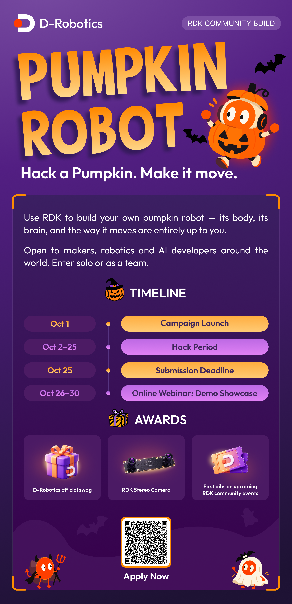

# RDK Community Build

> The official Community developer project hub for discovering, collecting, and showcasing what people build with D-Robotics RDK.

## About this hub

RDK Community Build turns community experiments into reusable references. Each challenge keeps its own brief, schedule, submission guide, and curated project index here, while every developer or team continues to own and maintain its source repository.

This repository is a showcase and discovery hub. It is not intended to duplicate participant repositories.

## Featured challenge

### Christmas Robot — Xmas Robots 🎄

[Merry Bots-mas! Build a Christmas robot with RDK.](Christmas-Robot/README.md) Registration opens **November 9, 2026**, submissions close **December 20**, and the Final Show & Tell takes place **December 23**. Include a Christmas element and make your robot move.

Keep your project in your own GitHub repository and prepare a **30-second demo video**. No pull request to this hub is required for Xmas Robots. See the [activity page](Christmas-Robot/README.md) for participation details.

### Pumpkin Robot Challenge

  

Explore the [Pumpkin Robot Challenge](Pumpkin-Robot-Challenge/README.md): campaign launch on Oct 1, hack period from Oct 2–25, and community demo showcase from Oct 26–30.

## Challenges

| Challenge | Theme | Status |
| --- | --- | --- |
| [Christmas Robot — Xmas Robots](Christmas-Robot/README.md) | **Build a Christmas robot with RDK. Make it move.** | Registration opens November 9, 2026 |
| [Pumpkin Robot Challenge](Pumpkin-Robot-Challenge/README.md) | **Hack a Pumpkin. Make it move.** | Preparing |

## How it works

1. Pick a challenge and review its requirements.
2. Build and document the project in your own GitHub repository.
3. Publish a demo video that clearly shows the result.
4. Follow the submission instructions for your chosen challenge: **Xmas Robots** requires your own repository and a 30-second demo video, with no pull request to this hub required; **Pumpkin Robot Challenge** uses a project-profile pull request.
5. This hub aggregates and showcases community projects according to each challenge's process.

Participant source code is never merged into this repository. Each creator keeps ownership and maintenance of their own project repository.

## What a featured project should explain

- What the project does
- Demo video and project photos
- Main features and bill of materials
- How RDK is used
- System architecture
- Future ideas and source code

## Resources

- [D-Robotics Developer Center](https://developer.d-robotics.cc/rdk_doc_center/)
- [RDK documentation source](https://github.com/D-Robotics/rdk_doc)
- [RDK Model Zoo](https://github.com/D-Robotics/rdk_model_zoo)
- [D-Robotics on GitHub](https://github.com/D-Robotics)

## License

Each linked community project is governed by the license in its own repository.
